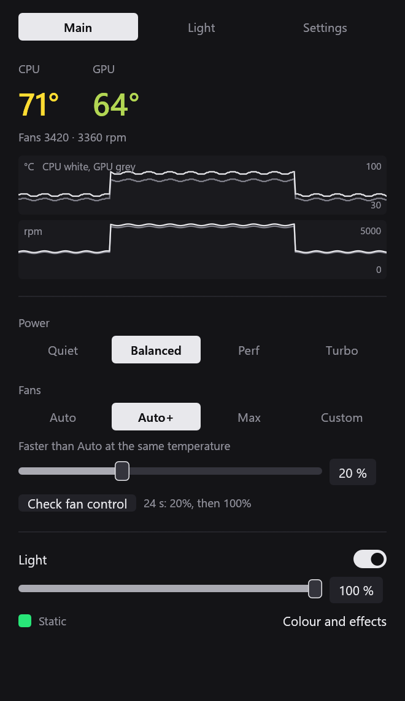
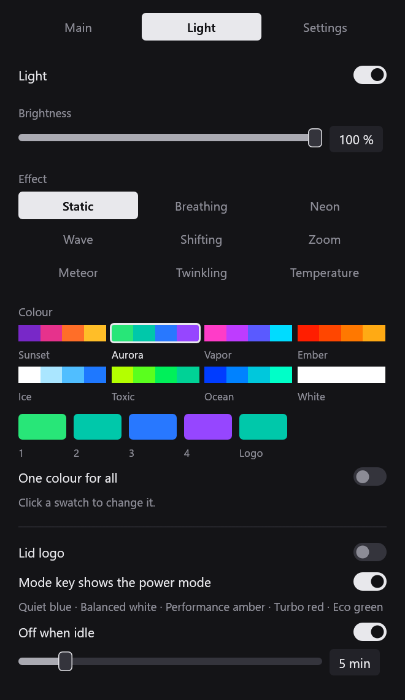
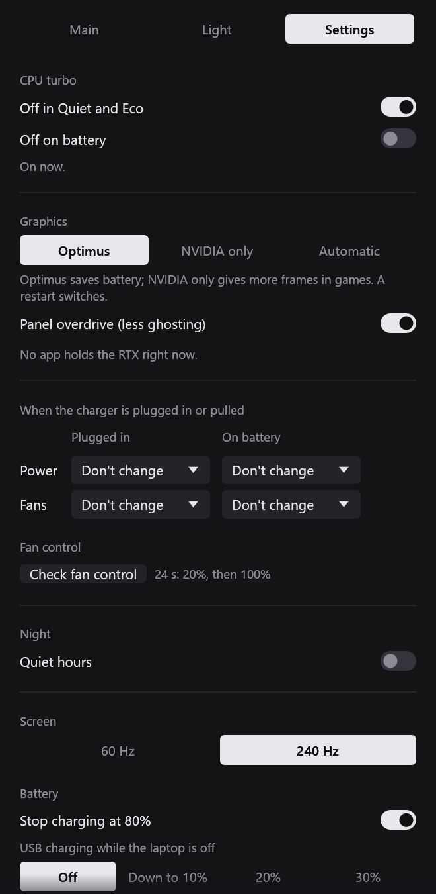

# Kelvin

Fans, power modes and keyboard lighting for Acer Predator laptops on Windows, without PredatorSense.
One 9 MB exe, no runtime, no Acer services.

Made on a **Predator Helios Neo 16 AI (PHN16-73)**. On this 2025 model the keyboard lighting is driven
over HID by an ENE KB5130 chip and ignores the WMI calls older tools use, so those tools leave the
keyboard dark; Kelvin talks to the chip directly. Other Predator and Nitro models with the same
firmware interfaces may work; reports are welcome.

  

## What it does

- **Power modes**: Quiet, Balanced, Performance, Turbo, Eco, with rules for charger and battery.
- **Fans**: Auto, Auto+ (the firmware's Auto run N% faster, learned per power mode), Max, fixed speed,
  curve. Over 95 °C for 10 s in a mode Kelvin steers, the fans go to Max until 85 °C.
- **Lighting**: 8 built-in effects plus Temperature (colour follows CPU/GPU heat), a colour per keyboard
  zone, 8 ready-made schemes, the lid logo on or off, the mode key's LED showing the power mode, lights off
  after N idle minutes.
- **CPU turbo off** in Quiet and Eco (and optionally on battery): cooler and quieter.
- **GPU mode**: Optimus, NVIDIA only, automatic (applies after a restart). Experimental.
- **Apps keeping the RTX awake**, with one click to move an app to the integrated GPU.
- Panel overdrive, 80% charge limit, USB charging while off, boot animation and sound.
- Night schedule, Game Sync (settings while a game runs), refresh rate.
- The PredatorSense key and Ctrl+Alt+P cycle power modes; Ctrl+Alt+F fans, L light, O window.
- Screen off (Ctrl+Alt+D, tray or a button): the display goes dark, music, downloads and games keep running and the laptop does not sleep; any key wakes it.
- Temperature in the tray icon. Starts with Windows, hidden in the tray.

## Install

Download `Kelvin.exe` from [Releases](../../releases) and run it. It asks for administrator rights: the
Acer firmware interface answers administrators only. Windows SmartScreen will warn about an unknown
publisher, as for any unsigned exe.

Close PredatorSense and other Predator tools first; two programs driving the same fans undo each other
(Kelvin shows a warning and a button to close them).

## Not verified everywhere

- **Fan speeds** in Auto+, Fixed and Curve: on the PHN16-73 the firmware keeps its own minimum speed
  when hot. Settings → Fan control → *Check fan control* shows in 24 s whether your fans follow set speeds.
- **GPU mode** switching follows Acer's agent service as decoded by Linuwu-Sense; tested there on one
  Nitro model.

Kelvin writes every firmware call and its reply to `%LOCALAPPDATA%\Kelvin\log.txt`. Attach it to an issue
if something does nothing on your model.

## Where the protocols come from

- Lighting report 0xA4 and its fields: Acer's own `AcerLightingService` driver package; effect bytes as in
  [kbrgb](https://github.com/shwetankg07/kbrgb).
- Firmware method ids, misc settings, USB charging values, the key event, GPU mode: Linux `acer-wmi` and
  [Linuwu-Sense](https://github.com/0x7375646F/Linuwu-Sense).
- Started as a rewrite of [Acer-P-Helper](https://github.com/supesonly/Acer-P-Helper) (MIT, see
  `LICENSE-Acer-P-Helper`).

Not affiliated with Acer. Predator and PredatorSense are Acer's trademarks. Use at your own risk.

## Build

```
cargo build --release
```

`cargo run --example probe` checks the lighting controller and the WMI class; `cargo run --example shots`
renders the screenshots above with demo data.

## License

MIT
